<div align="center">
  
  <h1>SŌZŌ Studio</h1>
  <p><strong>A Precision Visual Web Development Workshop</strong></p>
  <p>Apple-inspired, desktop-first visual environment for designing CSS components, motion curves, website architecture, and auditing security.</p>
</div>

---

## ✦ Core Philosophy

Everything in **SŌZŌ Studio** is manually controlled through drawing, dragging, dropping, selecting, configuring, and coding. 

- **Zero AI Dependency:** 100% deterministic, private, and local-first.
- **Offline-Capable:** Fully persists to browser IndexedDB with zero telemetry.
- **No Paid Clouds:** Pure open-source, standards-compliant web technologies.
- **Bi-Directional Sync:** Visual canvas changes and source code edits remain synchronized in real time.

---

## ✦ The 6 Specialized Workspaces

| Workspace | Purpose |
|---|---|
| **Design Studio** | Precision vector canvas with tools for rectangles, rounded cards, circles, polygons, stars, lines, arrows, and typography with instant CSS & SVG code generation. |
| **Animation Lab** | Final Cut / Motion-quality visual timeline with draggable keyframe diamonds, playhead scrubbing, easing curves (`cubic-bezier(0.16, 1, 0.3, 1)`), and CSS `@keyframes` export. |
| **UI Builder** | Webflow-grade responsive website builder with drag-and-drop component palette, inline `contentEditable` text editing, multi-page routing, and viewport switching (Desktop, Tablet 768px, Mobile 375px). |
| **Website Graph** | Node-based architecture diagram powered by `@xyflow/react`. Visualizes project hierarchy, route connections, and component dependencies with click-to-navigate capabilities. |
| **Code Studio** | Monaco Editor experience with multiple file tabs, syntax highlighting for HTML, CSS, JavaScript, and TypeScript, live split sandbox preview, and diagnostics console. |
| **Security Lab** | Linear-styled diagnostic dashboard providing heuristic static analysis for hardcoded secrets, unsafe `innerHTML`, potential XSS/injection, CSP policy generation, and 1-click remediations. |

---

## ✦ Technology Stack

- **Framework:** React 19 + TypeScript + Vite
- **Styling:** Tailwind CSS v4 + Custom Apple Pro design tokens
- **Graph Engine:** React Flow (`@xyflow/react`)
- **Code Editor:** Monaco Editor (`@monaco-editor/react`)
- **State Management:** Zustand
- **Local Storage:** IndexedDB (`idb`) with resilient fallback
- **Export Engine:** JSZip (produces runnable standalone websites)
- **Icons:** Lucide React

---

## ✦ Getting Started

### Prerequisites
- Node.js (v18+)
- npm or pnpm

### Installation & Run

```bash
# Clone the repository
git clone https://github.com/anitikrish-ai/S-Z-.git
cd S-Z-

# Install dependencies
npm install

# Start local development server
npm run dev
```

Visit `http://localhost:5173` to launch **SŌZŌ Studio**.

---

## ✦ Export Deliverables

Clicking **Export** in the top toolbar packages the entire workspace into a clean standalone `.zip` containing:
- `index.html` — Semantic responsive website markup
- `styles.css` — Production CSS styling with tokens and component classes
- `app.js` — Vanilla interactive scripts
- `assets/vector-elements.svg` — Clean vector graphics
- `assets/animations.css` — High-performance CSS keyframe animations
- `reports/security-audit.json` — Static vulnerability analysis report
- `sozo-project.json` — Complete project file for 1-click reimport into SŌZŌ Studio

---

## ✦ License

Open source under the [MIT License](LICENSE).
